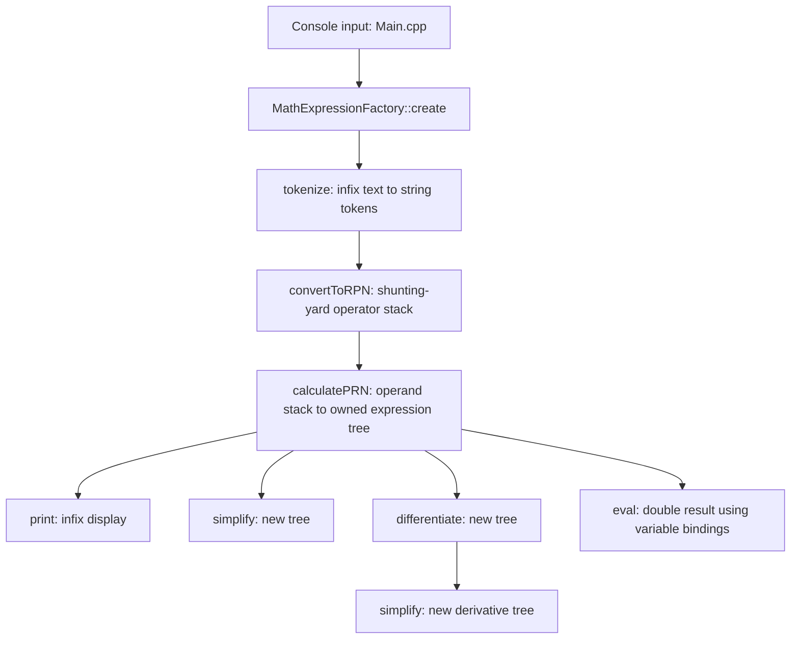

# Architecture

Symbolica is a C++14 console application built around an owned, polymorphic
expression tree. The same tree supports printing, numerical evaluation, symbolic
differentiation, variable discovery, and local simplification. There is no external
math library, persistence layer, or background service.

For build instructions, see the [README](../README.md). For defects and design
limitations, see [known issues](known-issues.md). Public headers use Doxygen-style
comments; concrete overrides follow the base contract and their class notes.

## Request flow

The console prints the parsed expression, a simplified copy, the derivative with
respect to `x`, and a simplified derivative. It does not expose numeric evaluation
or variable assignments. `eval()` is available to C++ callers. Each iteration
catches `std::exception` and prints its message; it cannot recover from undefined
behavior in the parser.

`exit` is checked by the loop condition after the input has already been parsed,
so it currently produces an error before exiting. End-of-input is not handled.

## Components and dependencies

| Component | Responsibility | Depends on |
| --- | --- | --- |
| [Console](../Calculator/src/Main.cpp) | Read lines and display transformations | Expression factory and expression API |
| [Factory](../Calculator/include/parsing/MathExpressionFactory.h) | Coordinate the three parsing stages | Shunting-yard helpers |
| [Parser](../Calculator/include/parsing/ShuntingYard.h) | Recognize tokens, reorder operators, construct nodes | All concrete expression types |
| [Expression hierarchy](../Calculator/include/expressions/MathExpression.h) | Recursive math operations and formatting | Variable bindings and owning handler |
| [Variable bindings](../Calculator/include/expressions/VariableInterpretation.h) | Store up to 26 registered names and values | Fixed arrays and a cached count |
| [Owning handler](../Calculator/include/utility/poly_obj_handler.hpp) | Delete, clone, and move polymorphic nodes | A type exposing `clone()` |

Headers live in `Calculator/include`; implementations live in `Calculator/src`.
Expression implementations are grouped into leaves, binary operations, and unary
operations/functions. The Visual Studio project explicitly lists the files, and
its `.filters` file mirrors their physical folders. There is one application
target; the expression engine is not a separate library target.

## Parsing and input language

`MathExpressionFactory::create()` calls these stages in order:

1. `tokenize()` splits at special symbols and trims each remaining fragment. It
   rewrites a minus at the start, after `(`, or after a binary operator to `neg`.
2. `convertToRPN()` uses an operator stack to produce reverse Polish notation.
   For example, `x+2*3` becomes `x 2 3 * +`.
3. `calculatePRN()` pushes leaves onto an operand stack and replaces operands with
   operation nodes. Binary operations pop the right operand before the left.
   It expects exactly one final tree. Its historical name transposes RPN to PRN;
   it constructs a tree rather than calculating a numeric value.

These stages use string tokens and global helper functions. Recognition and arity
checks are not a complete grammar; malformed input is sometimes accepted or unsafe.
The following table describes the intended vocabulary, subject to the parser
problems in the [issue list](known-issues.md#parser-validation-and-input-handling).

| Input | Supported spellings and intended interpretation |
| --- | --- |
| Variables | Single lowercase letters `a` through `z` |
| Numbers | Decimal digits with an optional internal decimal point, e.g. `12`, `3.5`; minus is normally a separate unary token |
| Named constants | `_pi`, `_e`; converted to numeric `Constant` leaves |
| Unary functions | `sin(x)`, `cos(x)`, `tg(x)`, `cotg(x)`, `sqrt(x)`, `ln(x)` |
| Binary operators | `+`, `-`, `*`, `/`, `^` |
| Grouping | Parentheses; multiplication must be explicit |

Names are case-sensitive and trigonometric arguments use radians. Multi-letter
variables, scientific notation, implicit multiplication, `.5`, and `5.` are not
supported. Commas are tokenized and handled by the operator stack, but there are
no multi-argument functions or defined comma-expression semantics.

The parser gives `+`/`-` precedence 1, `*`/`/` precedence 3, and `^`/`neg` precedence
4. The first four binary operators associate left; exponentiation and negation
associate right. For example, `2^3^2` groups as `2^(3^2)`, and `-x^2` groups as
`-(x^2)`. Display methods maintain a separate precedence scale: sums 1, products 2,
powers/negation 3, functions 4, leaves 5. These are not interchangeable APIs.

## Expression nodes and ownership

`MathExpression` is the abstract base for all nodes. `Constant` and `Variable`
are leaves. `BinaryOperation` owns ordered `operand1` and `operand2` children;
`UnaryOperation` owns one child. `UnaryFunction` adds a function name and common
`name(argument)` printing. Math operations use virtual dispatch and recursion;
there is no visitor or central symbolic rewrite engine.

`MathExpressionHandler` aliases `poly_obj_handler<MathExpression>`. Each handler
owns one node exclusively, and each node owns its children through handlers:

- Constructing from a raw pointer adopts it. The pointer must not already have
  another owner, and stack objects must not be passed this way.
- Copying a handler calls the node's virtual `clone()`, recursively duplicating
  descendants. Two copies do not share mutable subtrees.
- Moving transfers the pointer and leaves the source handler empty.
- Forwarding constructors copy lvalue handlers and move rvalue handlers.
- `clone()` returns a raw owning pointer; callers must adopt or delete it.
- `getPtr()` returns a borrowed pointer. Handler equality compares pointer identity,
  so it does not test whether two expression trees represent the same expression.
- Empty-handler dereference throws `std::logic_error`.

Expression objects themselves disable copying; clients copy handlers instead.
`differentiate()` and `simplify()` are const operations that construct new trees.
The handler's assignment/reset exception-safety defects are documented separately.

## Evaluation and variables

Evaluation recursively returns `double`. `VariableInterpretation` holds a value
array and a participation array indexed by `name - 'a'`. A registered variable may
have value zero; an unregistered variable is an error. `addVar()` inserts or
overwrites a binding, and `operator[]` only accesses registered names.

`populateVariables()` traverses the tree and calls `addVar(name)` with its default
zero value, so callers should discover variables before setting numeric values.
It overwrites values in a reused binding set. `VariableInterpretation::Empty`
is the shared binding set used when folding variable-free subtrees.

Domain handling is local to each node. `ln` rejects nonpositive evaluated inputs,
`sqrt` rejects negative evaluated inputs, and `Power::eval()` rejects all negative
bases. Division does not check its denominator. Simplification does not consistently
use these same checks; see [domain issues](known-issues.md#mathematical-domain-and-simplification).

## Differentiation and simplification

Each concrete node implements its own derivative rule. Here `u` and `v` are child
expressions, and primes mean differentiation with respect to the requested name.

| Node | Constructed derivative |
| --- | --- |
| Constant / matching variable / other variable | `0` / `1` / `0` |
| Sum / difference | `u' + v'` / `u' - v'` |
| Product | `u' * v + u * v'` |
| Quotient | `(u' * v - u * v') / v^2` |
| Power | `u^v * ((u' / u) * v + ln(u) * v')` |
| Negation | `-u'` |
| Sine / cosine | `cos(u) * u'` / `-(sin(u) * u')` |
| Tangent / cotangent | `u' / cos(u)^2` / `-(u' / sin(u)^2)` |
| Square root / natural logarithm | `u' / (2 * sqrt(u))` / `u' / u` |

The power rule is applied even to constant exponents. This can introduce undefined
subexpressions into an otherwise valid derivative, such as at zero for `x^2`.

`simplify()` first simplifies children, folds variable-free expressions, and applies
local identities such as `u+0 -> u`, `u*1 -> u`, and `u^1 -> u`. It does not collect
like terms (`x+x` remains `x+x`), cancel symbolic factors, or repeatedly rewrite
until a canonical form is reached. Some rules remove domain restrictions, and
folding can produce NaN or infinity. `areEqual()` uses an absolute difference
strictly below `std::numeric_limits<double>::epsilon()` to choose identities.

## Extending the engine

To add an operation, implement a node and its evaluation, printing, derivative,
and simplification behavior. Define explicit mathematical domain rules before
adding identities. For parser-visible operations, also update recognition,
construction dispatch, spelling constants where relevant, and precedence/
associativity for operators. Update the Visual Studio project and filters for
new files. Recognition and behavior are currently distributed across these places.

There is no committed automated test suite or CI configuration. Changes to the
engine should be checked for parsing validity, tree ownership, print/reparse
behavior, derivative values away from and at boundaries, and agreement between
evaluation before/after simplification. The issue list proposes a repair order.
